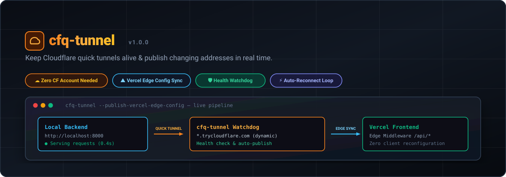

# cfq-tunnel



Keeps a Cloudflare quick tunnel (`*.trycloudflare.com`) in front of a self-hosted service and tells the rest of your stack where it went every time the address changes.

Quick tunnels need no Cloudflare account and no domain, and they are fast. Their weakness is the address: it is random and it changes whenever `cloudflared` restarts. cfq-tunnel runs `cloudflared`, checks your service through the tunnel, starts a fresh tunnel when the old one dies, and publishes each new address to Vercel Edge Config, a webhook, a file or a shell hook.

It came out of running a FastAPI backend on a home server behind a Vercel frontend, where ngrok's free tier took 3 to 6 seconds per request (and often failed) and a quick tunnel answered in under half a second.

---

## Contents

- [The Problem](#the-problem)
- [How It Works](#how-it-works)
- [Architecture](#architecture)
- [Install](#install)
- [Quick Start](#quick-start)
- [Commands](#commands)
- [Publishing the Address](#publishing-the-address)
- [Running as a Service](#running-as-a-service)
- [Frontend on Vercel](#frontend-on-vercel)
- [Things That Bite](#things-that-bite)
- [Development & Testing](#development--testing)
- [License](#license)

---

## The Problem

`cloudflared tunnel --url http://localhost:8000` gives you a public HTTPS address in seconds. Then:

- the process restarts (a crash, a reboot, a network drop) and the address is gone; the new one is different;
- your frontend, your mobile app or your webhook provider still points at the old one;
- nothing tells you, and `cloudflared` keeps running even when the tunnel behind it has stopped answering.

A named tunnel fixes the address but needs a domain on Cloudflare's DNS. cfq-tunnel is for when you want quick tunnels anyway.

## How It Works

1. Starts `cloudflared tunnel --url <origin>` with its metrics server on a known port.
2. Reads the assigned hostname from `cloudflared`'s `/quicktunnel` metrics endpoint.
3. Waits until the new hostname actually answers (fresh hostnames take a few seconds to resolve).
4. Publishes `https://<host>.trycloudflare.com` to every configured target. A failed publish is retried on the next pass.
5. Every 15 seconds, requests your health path through the tunnel. Anything below 500 counts as up; Cloudflare answers 502/530 when the tunnel is gone.
6. After 3 failures in a row, or when `cloudflared` exits, stops it and goes back to step 1.

On SIGTERM or Ctrl-C it stops its `cloudflared` before exiting.

## Architecture

```text
 +----------------------+        +-------------------------------+
 |  Browser / client    |        |  Vercel (or any frontend)     |
 +----------+-----------+        |  middleware reads api_origin  |
            |                    |  from Edge Config, proxies    |
            | HTTPS              |  /api to the current tunnel   |
            v                    +---------------+---------------+
 +----------------------+                        ^
 |  <random>.trycloud-  |<-----------------------+   new address
 |  flare.com           |                        |
 +----------+-----------+        +---------------+---------------+
            |                    |  cfq-tunnel                    |
            |  quick tunnel      |  - runs cloudflared            |
            v                    |  - health-checks through it    |
 +----------------------+        |  - restarts after failures     |
 |  cloudflared         |<-------+  - publishes: Edge Config,     |
 +----------+-----------+        |    webhook, file, shell hook   |
            |                    +-------------------------------+
            v
 +----------------------+
 |  Your service        |
 |  http://127.0.0.1:N  |
 +----------------------+
```

## Install

Needs Python 3.8+ and [`cloudflared`](https://developers.cloudflare.com/cloudflare-one/connections/connect-networks/downloads/). No Python dependencies.

```bash
curl -fsSL https://raw.githubusercontent.com/mr-ceo7/cfq-tunnel/main/install.sh | bash
```

or from a clone:

```bash
git clone https://github.com/mr-ceo7/cfq-tunnel && cd cfq-tunnel && ./install.sh
# or: pip install .
```

`./uninstall.sh` removes it.

## Quick Start

```bash
# Fastest way: tunnel a local port in one command (just like ngrok)
cfq-tunnel http 3000

# Or simply:
cfq-tunnel 3000

# Tunnel with publishers (write to file & run a hook on address change)
cfq-tunnel http 8000 \
  --write-file ~/.cache/my-app-url \
  --on-change 'echo "now at $CFQ_URL"'
```

```text
2026-10-28 22:10:53 INFO Starting a quick tunnel to http://127.0.0.1:8000
2026-10-28 22:11:05 INFO Published https://url-structured-kind-fragrance.trycloudflare.com to file, command
```

Kill the `cloudflared` process and watch a new address get published about 15 seconds later.

## Commands

### `cfq-tunnel http <port-or-url>`
Runs a tunnel pointing to a local port or URL (e.g. `cfq-tunnel http 3000` or `cfq-tunnel 3000`). Accepts all the same options as `run`.

### `cfq-tunnel run`

| Option | Default | |
|---|---|---|
| `--url URL` | required | The origin the tunnel serves |
| `--health-path PATH` | `/` | Requested through the tunnel; use a cheap endpoint such as `/health` |
| `--interval SECONDS` | `15` | Time between health checks |
| `--failures N` | `3` | Failed checks in a row before a fresh tunnel |
| `--metrics HOST:PORT` | `127.0.0.1:20242` | `cloudflared` metrics address. **Use a different port per tunnel on one machine** |
| `--cloudflared PATH` | from `PATH` | |
| `--ipv4` | off | Resolve over IPv4 only for health checks (see [Things That Bite](#things-that-bite)) |

Publishing options are below.

### `cfq-tunnel status [--metrics HOST:PORT]`

Prints the current tunnel URL, or exits 1 when no tunnel answers on that metrics port.

### `cfq-tunnel systemd [--name N] [--user U] [--env-file F] -- <run options>`

Prints a systemd unit for the given run options. See [Running as a Service](#running-as-a-service).

## Publishing the Address

Combine as many as you need; every one receives each new address.

### Vercel Edge Config

```bash
export VERCEL_TOKEN=...          # vercel.com/account/tokens, scoped to the team that owns the store
cfq-tunnel run --url http://127.0.0.1:8000 \
  --edge-config ecfg_xxxxxxxx --vercel-team team_xxxxxxxx --edge-config-key api_origin
```

Upserts the item `api_origin` (or your key) with the URL. Reading Edge Config from Vercel middleware takes milliseconds and needs no redeploy, which makes it a good fit for a proxy; see [Frontend on Vercel](#frontend-on-vercel). The token is read from the environment variable named by `--vercel-token-env` (default `VERCEL_TOKEN`), never from the command line.

### Webhook

```bash
CFQ_WEBHOOK_TOKEN=s3cret cfq-tunnel run --url http://127.0.0.1:8000 --webhook https://example.com/tunnel-address
```

POSTs `{"url": "https://<host>.trycloudflare.com", "hostname": "<host>.trycloudflare.com"}`, with `Authorization: Bearer $CFQ_WEBHOOK_TOKEN` when set. Any 2xx counts as delivered. [`examples/webhook_receiver.py`](examples/webhook_receiver.py) is a FastAPI receiver.

### File

```bash
cfq-tunnel run --url http://127.0.0.1:8000 --write-file /run/my-app/url
```

Writes the URL and a newline, atomically (write to a temp file, then rename).

### Shell hook

```bash
cfq-tunnel run --url https://localhost:443 \
  --on-change 'sed -i "s#PUBLIC_URL=.*#PUBLIC_URL=$CFQ_URL#" /srv/app/.env && docker restart app'
```

Runs through the shell with `CFQ_URL` and `CFQ_HOSTNAME` set, and `{url}` replaced in the command. A non-zero exit counts as a failed publish and is retried. Hooks time out after 60 seconds.

## Running as a Service

```bash
cfq-tunnel systemd --name my-api --env-file /etc/cfq-tunnel/my-api.env -- \
  --url http://127.0.0.1:8000 --health-path /health --metrics 127.0.0.1:20242 \
  --edge-config ecfg_xxxxxxxx --vercel-team team_xxxxxxxx \
  | sudo tee /etc/systemd/system/my-api-tunnel.service

sudo install -m 600 /dev/null /etc/cfq-tunnel/my-api.env   # then put VERCEL_TOKEN=... in it
sudo systemctl daemon-reload && sudo systemctl enable --now my-api-tunnel
journalctl -u my-api-tunnel -f
```

Restarting the service gives the tunnel a new address, so leave it alone during routine deploys of your app; cfq-tunnel only needs a restart when its own options change.

## Frontend on Vercel

[`examples/vercel-middleware.js`](examples/vercel-middleware.js) is a Routing Middleware for any framework on Vercel. It proxies `/api` and `/auth` to the address in Edge Config, so the browser only ever talks to your Vercel domain and cookies stay first-party. It caches the address for 30 seconds and, when a request fails because the tunnel moved, reads Edge Config again and retries once. During a tunnel change, visitors see a 503 for roughly 20 to 40 seconds.

Set `EDGE_CONFIG` (the store's connection string, created from a read token) in the Vercel project.

**WebSockets.** Vercel cannot proxy them, so browsers have to connect to the tunnel itself. Have your backend read the address from `cloudflared`'s metrics endpoint and hand it to the client, as in [`examples/fastapi_ws_url.py`](examples/fastapi_ws_url.py). A WebSocket opened directly on the tunnel does not carry your frontend's cookies, so authenticate it with a short-lived ticket from an API call.

## Things That Bite

These all happened in production.

- **ERR_CONTENT_DECODING_FAILED behind a proxy.** Cloudflare gzips responses. `fetch` in an edge proxy decompresses the body but keeps `Content-Encoding: gzip` on the headers; pass those through and browsers try to decompress again. Drop `content-encoding` and `content-length` from the proxied response (the example does).
- **Your 502s become Cloudflare's 502 page.** When your service itself answers 502, Cloudflare replaces the body with its own HTML error page and your JSON error message is lost. Use 422 or 503 for upstream failures.
- **Fresh hostnames don't resolve straight away.** The first health check against a brand-new hostname can fail for a few seconds. cfq-tunnel waits up to 60 seconds for it to answer before publishing and needs 3 failures in a row before giving up on a tunnel.
- **IPv6 on home networks.** Some networks resolve the tunnel over IPv6 but can't route it, which makes a healthy tunnel look dead. `--ipv4` keeps the health checks on IPv4.
- **Two tunnels, one metrics port.** Each `cloudflared` on a machine needs its own `--metrics` port, or cfq-tunnel reads the other tunnel's hostname.
- **Quick tunnels are best-effort.** Cloudflare describes them as intended for testing and development, with no uptime guarantee and some [limitations](https://developers.cloudflare.com/cloudflare-one/connections/connect-networks/do-more-with-tunnels/trycloudflare/). When you have a domain on Cloudflare, a named tunnel gives you a fixed address and you won't need this.

## Development & Testing

```bash
git clone https://github.com/mr-ceo7/cfq-tunnel && cd cfq-tunnel
python3 -m pip install pytest
python3 -m pytest -q
```

The tests run the watchdog against a fake `cloudflared` and fake clock, and the publishers against a local HTTP server; they need no network and no Cloudflare account.

## License

MIT. See [LICENSE](LICENSE).
